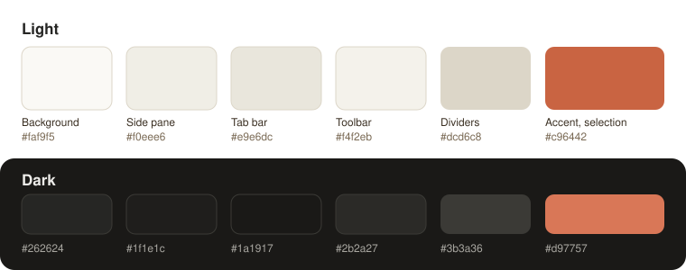

# Warm Theme for Zotero

[English](README.md) | 中文

一套适用于 Zotero 7 及以上版本的暖色主题。白色和灰色的界面换成象牙白与米色，蓝色的强调色换成焦橙色。覆盖范围包括文献库、条目列表、条目面板、设置和各种对话框，以及 PDF 阅读器的工具栏和侧栏。深色模式下会换成相配的暖深灰配色。

<p align="center"></p>

本项目为个人开发的非官方插件，与 Zotero 官方无关联。

## 安装

1. 在 [Releases 页面](https://github.com/YufeiXIA/zotero-warm-theme/releases) 下载最新的 `.xpi` 文件。
2. 在 Zotero 中打开 Tools > Plugins（工具 > 插件），点右上角的齿轮图标，选择 Install Plugin From File...（从文件安装），选中刚下载的 `.xpi` 文件。

插件启用后，主题立即生效。

## 开关主题

在菜单里点"工具 > 暖色主题"（英文界面为 Tools > Warm Theme）。切换立即生效，不需要重启。关掉主题，或者停用、卸载插件，Zotero 都会恢复原来的配色。

主题会跟随 Zotero 的配色方案设置（Settings > General > Appearance and Language，即"设置 > 常规 > 外观和语言"；选 Automatic 时跟随系统）。它只改颜色，字体、字号和布局都保持原样，PDF 页面本身也不受影响。

## 工作原理

从 7.0 版开始，Zotero 的界面颜色由一组 CSS 变量控制，比如 `--material-background`、`--material-sidepane`、`--color-accent` 等。插件只加了一份样式表，在窗口根元素带有 `zwt-theme` 属性时给这些变量换上新的值。开关主题，就是在所有打开的 Zotero 窗口上加上或去掉这个属性。之后新打开的窗口，会在加载时自动带上这份样式。

PDF 阅读器的界面运行在一个独立的文档里，没法直接加载插件的文件，所以插件会把同样的规则以内联 `<style>` 的形式放进去。

所有颜色都写在 [`addon/content/theme.css`](addon/content/theme.css) 里。想换一个强调色的话，改掉其中的 `--zwt-accent`，再自己打包一份即可。

## 已知限制

- 其他插件如果自己指定了颜色（比如某些侧栏和面板），这些部分会保持原样。
- 目前在 Windows 版 Zotero 10.0.6 上测试过。macOS 和 Linux 上的 Zotero 7 及以上版本使用同一套变量，但还没有实际验证。

## 从源码构建

```
python scripts/build.py
```

运行后会生成 `build/zotero-warm-theme-<版本号>.xpi` 和 `build/update.json`。Zotero 通过 `update.json` 检查更新，所以发布时要把这两个文件都上传到标签为 `v<版本号>` 的 GitHub Release。

## 相关项目

[Claude Code for Zotero](https://github.com/YufeiXIA/zotero-claude-code)：在 Zotero 里和正在读的论文对话的插件，用的也是这套配色。

## 许可证

[MIT](LICENSE)
